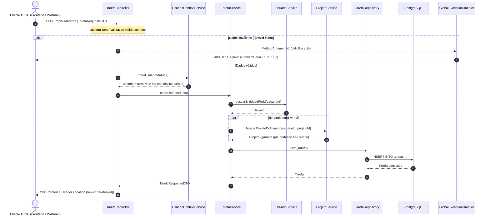
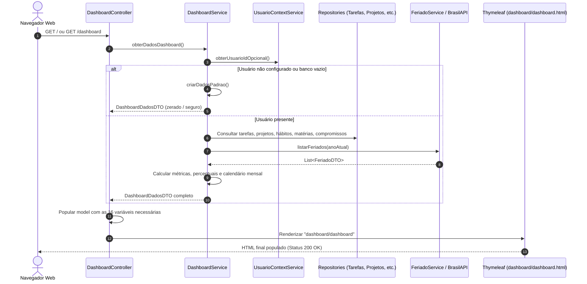

# Guia Técnico de Arquitetura e Funcionamento — IntelliPlan

Este documento apresenta a especificação técnica detalhada da arquitetura, do fluxo de execução, do modelo de dados, dos contratos de API e das integrações do **IntelliPlan — Organizador Pessoal Inteligente**.

---

## 1. Visão Geral e Estilo Arquitetural

O IntelliPlan é estruturado como um monolito modular baseado em **Java 21** e **Spring Boot 4.1.2**, utilizando persistência relacional com **PostgreSQL** e **Spring Data JPA / Hibernate**, empacotado no formato **WAR (Web Application Archive)**.

A aplicação atende simultaneamente a dois canais de consumo:
1. **Interface Web Server-Side:** Renderizada com **Thymeleaf**, **Tailwind CSS** (via CDN) e **JavaScript vanilla** para interação no navegador.
2. **API RESTful:** Disponibilizada sob o prefixo `/api/v1/`, formatada em JSON com validação Jakarta Bean Validation e documentação padronizada **OpenAPI 3.0 / Swagger UI**.

### Princípios de Engenharia Adotados

- **Injeção de Dependências Explícita:** Todos os componentes do Spring utilizam injeção via construtor, sem uso de anotações `@Autowired` em campos ou setters.
- **Sem Lombok:** Todas as entidades possuem construtores, getters e setters explícitos; todos os DTOs utilizam **Java Records**.
- **Isolamento de Usuário por Padrão:** As consultas e mutações em entidades associadas a usuários sempre validam o identificador do usuário corrente, prevenindo acesso cruzado (IDOR).
- **Tratamento de Exceções Padronizado:** Erros de validação, integridade, regras de negócio e recursos não encontrados são mapeados pelo `GlobalExceptionHandler` no formato RFC 7807 (`ProblemDetail`).
- **Resiliência em Integrações:** Falhas em serviços externos (ex.: BrasilAPI) são capturadas de forma defensiva com logging de advertência, retornando fallbacks sem interromper o fluxo da aplicação.

---

## 2. Estrutura de Pacotes

A organização de código do IntelliPlan adota modularização por domínio funcional:

```
com.planner
├── agenda
│   ├── controller      # CompromissoController (REST)
│   ├── dto             # CompromissoRequestDTO, CompromissoResponseDTO
│   ├── entity          # Compromisso (JPA)
│   ├── repository      # CompromissoRepository (Spring Data JPA)
│   └── service         # CompromissoService (Regras de negócio e isolamento)
├── common
│   ├── context         # UsuarioContextService (Resolução do usuário corrente)
│   ├── exception       # BusinessRuleException, ResourceNotFoundException, DuplicateResourceException
│   └── handler         # GlobalExceptionHandler (@RestControllerAdvice)
├── config              # SecurityConfig (BCryptPasswordEncoder e SecurityFilterChain)
├── dashboard
│   ├── controller      # DashboardController (@Controller para renderização Thymeleaf e ações MVC)
│   ├── dto             # DiaHabitoDTO, DiaCalendarioDTO, TarefaItemDTO, ProjetoItemDTO, MateriaItemDTO, DashboardDadosDTO
│   └── service         # DashboardService (Agregação de métricas, progresso e calendário)
├── estudos
│   ├── controller      # MateriaController, ConteudoEstudoController (REST)
│   ├── dto             # MateriaRequestDTO, MateriaResponseDTO, ConteudoEstudoRequestDTO, ConteudoEstudoResponseDTO
│   ├── entity          # Materia, ConteudoEstudo (JPA)
│   ├── repository      # MateriaRepository, ConteudoEstudoRepository
│   └── service         # MateriaService, ConteudoEstudoService
├── habitos
│   ├── controller      # HabitoController, RegistroHabitoController (REST)
│   ├── dto             # HabitoRequestDTO, HabitoResponseDTO, RegistroHabitoRequestDTO, RegistroHabitoResponseDTO
│   ├── entity          # Habito, RegistroHabito (JPA)
│   ├── repository      # HabitoRepository, RegistroHabitoRepository
│   └── service         # HabitoService, RegistroHabitoService
├── integracao
│   └── feriados
│       ├── client      # BrasilApiClient (RestClient HTTP com timeouts configurados)
│       ├── controller  # FeriadoController (REST para consulta de feriados)
│       ├── dto         # FeriadoDTO (Data, nome e tipo de feriado)
│       └── service     # FeriadoService (Encapsulamento defensivo da chamada externa)
├── projeto
│   ├── controller      # ProjetoController (REST)
│   ├── dto             # ProjetoRequestDTO, ProjetoResponseDTO
│   ├── entity          # Projeto (JPA)
│   ├── repository      # ProjetoRepository
│   └── service         # ProjetoService
├── tarefa
│   ├── controller      # TarefaController (REST)
│   ├── dto             # TarefaRequestDTO, TarefaResponseDTO
│   ├── entity          # Tarefa (JPA)
│   ├── repository      # TarefaRepository
│   └── service         # TarefaService
└── usuario
    ├── controller      # UsuarioController (REST)
    ├── dto             # UsuarioRequestDTO, UsuarioResponseDTO
    ├── entity          # Usuario (JPA)
    ├── repository      # UsuarioRepository
    └── service         # UsuarioService (Criptografia com BCrypt e validações)
```

---

## 3. Ciclo de Vida de uma Requisição

### 3.1 Requisição REST (Exemplo: Criação de Tarefa)



### 3.2 Requisição Web MVC (Exemplo: Acesso ao Dashboard)



---

## 4. Modelo de Dados e Entidades JPA

O modelo de dados é composto por 8 entidades relacionais com integridade referencial estrita e convenções padronizadas de chaves estrangeiras:

| Entidade | Tabela | Descrição | Relacionamentos Principais |
|---|---|---|---|
| `Usuario` | `usuarios` | Titular da conta e proprietário das informações. | Possui Tarefas, Projetos, Matérias, Compromissos, Hábitos. Restrição: `uk_usuarios_email`. |
| `Projeto` | `projetos` | Agrupador de escopos e atividades. | `ManyToOne` -> `Usuario` (`usuario_id`, FK obrigatória, Fetch LAZY). |
| `Tarefa` | `tarefas` | Unidade de atividade com status e prazo. | `ManyToOne` -> `Usuario` (`usuario_id`, FK obrigatória). `ManyToOne` -> `Projeto` (`projeto_id`, FK opcional). |
| `Materia` | `materias` | Disciplina ou área acadêmica/estudo. | `ManyToOne` -> `Usuario` (`usuario_id`, FK obrigatória, Fetch LAZY). |
| `ConteudoEstudo` | `conteudos_estudo` | Tópico ou capítulo de uma disciplina. | `ManyToOne` -> `Materia` (`materia_id`, FK obrigatória, Fetch LAZY). |
| `Compromisso` | `compromissos` | Evento pontual com horário de início e término. | `ManyToOne` -> `Usuario` (`usuario_id`, FK obrigatória, Fetch LAZY). |
| `Habito` | `habitos` | Ação recorrente monitorada com frequência diária, semanal ou mensal. | `ManyToOne` -> `Usuario` (`usuario_id`, FK obrigatória, Fetch LAZY). |
| `RegistroHabito` | `registros_habito` | Log de execução diária de um hábito. | `ManyToOne` -> `Habito` (`habito_id`, FK obrigatória, Fetch LAZY). Restrição: `uk_registro_habito_data (habito_id, data_registro)`. |

### Regras de Integridade e Constraints Críticas

1. **Unicidade de E-mail (`uk_usuarios_email`):** Não é permitido cadastrar mais de um usuário com o mesmo e-mail. Caso ocorra concorrência, a violação é capturada e transformada em `DuplicateResourceException` (HTTP 409).
2. **Unicidade de Registro de Hábito por Data (`uk_registro_habito_data`):** Um mesmo hábito não pode ter mais de uma confirmação na mesma data (`data_registro`). Tentativas duplicadas disparam `DuplicateResourceException` (HTTP 409).
3. **Isolamento de Domínio:** Atualizações e exclusões sempre verificam se `entidade.getUsuario().getId().equals(usuarioId)`. Caso não coincida, lança `ResourceNotFoundException`, impedindo que um usuário tome conhecimento da existência de registros de outros usuários.

---

## 5. Resolução de Contexto do Usuário (`UsuarioContextService`)

Para o estágio atual de desenvolvimento local (sem tela de login ou tokens JWT ativados), a identificação do usuário em requisições REST e na interface web é gerenciada de forma centralizada pelo `UsuarioContextService`:

```java
@Component
public class UsuarioContextService {
    private final Long devUsuarioId;
    private final UsuarioRepository usuarioRepository;
    // Injeção de app.dev.usuario-id e UsuarioRepository via construtor
}
```

### Regras de Funcionamento

1. **Configuração via Propriedade:** O arquivo `application.properties` declara:
   ```properties
   app.dev.usuario-id=1
   ```
2. **Método `obterUsuarioIdAtual()`:**
   - Se `app.dev.usuario-id` estiver ausente ou nulo: lança `BusinessRuleException` informando a necessidade de configurar a propriedade.
   - Se o identificador configurado não existir no banco de dados: lança `ResourceNotFoundException` explicitando o ID ausente.
   - Se existir: retorna o `Long` correspondente para uso pelos Services.
3. **Método `obterUsuarioIdOpcional()`:**
   - Retorna `Optional<Long>`.
   - Se a propriedade não estiver configurada ou o ID não existir, retorna `Optional.empty()`.
   - Utilizado pelo `DashboardService` para renderização defensiva com valores padrão sem estourar exceções na interface.
4. **Isenção de Endpoints Públicos:**
   - O cadastro de usuários (`POST /api/v1/usuarios`) não injeta nem consome o `UsuarioContextService`, permitindo o bootstrapping inicial de contas sem contexto prévio.

---

## 6. Integração com Feriados Nacionais (BrasilAPI)

O pacote `com.planner.integracao.feriados` provê sincronização de feriados nacionais para enriquecer a visualização da agenda e do calendário do dashboard.

### Componentes

1. **`FeriadoDTO`:**
   ```java
   public record FeriadoDTO(LocalDate date, String name, String type) {}
   ```
2. **`BrasilApiClient`:**
   - Utiliza o cliente HTTP nativo `RestClient` do Spring Boot.
   - Configura timeouts defensivos via `SimpleClientHttpRequestFactory`:
     - **Connect Timeout:** 3 segundos.
     - **Read Timeout:** 5 segundos.
   - Consulta: `GET https://brasilapi.com.br/api/feriados/v1/{ano}`.
3. **`FeriadoService`:**
   - Encapsula a invocação do client em bloco `try-catch`.
   - Em caso de falha de DNS, timeout de rede ou erro HTTP (4xx/5xx), registra log no nível `WARN` via SLF4J e retorna `Collections.emptyList()`.
   - **Garantia:** A aplicação nunca falha ou recusa requisições devido à indisponibilidade da API externa.
4. **`FeriadoController`:**
   - Endpoint: `GET /api/v1/feriados/{ano}`.
   - Documentado com Swagger/OpenAPI.
5. **Integração no Calendário do Dashboard:**
   - O `DashboardService` consulta os feriados do ano corrente e marca os dias do calendário que possuem feriado nacional com indicador de evento (`temEvento = true`).

---

## 7. Mapeamento da API REST

A API REST do IntelliPlan está integralmente mapeada sob `/api/v1` com as seguintes rotas e operações:

| Módulo | Método | Rota | Descrição | Códigos de Resposta |
|---|---|---|---|---|
| **Usuários** | `POST` | `/api/v1/usuarios` | Criação de novo usuário (senha hasheada com BCrypt) | 201, 400, 409 |
| | `GET` | `/api/v1/usuarios/{id}` | Busca de usuário por ID | 200, 404 |
| | `GET` | `/api/v1/usuarios/por-email` | Busca de usuário por e-mail (`?email=...`) | 200, 404 |
| **Projetos** | `POST` | `/api/v1/projetos` | Criação de projeto | 201, 400 |
| | `GET` | `/api/v1/projetos` | Listagem de projetos (filtro opcional `?status=...`) | 200 |
| | `GET` | `/api/v1/projetos/{id}` | Busca de projeto por ID | 200, 404 |
| | `PUT` | `/api/v1/projetos/{id}` | Atualização de projeto | 200, 400, 404 |
| | `DELETE` | `/api/v1/projetos/{id}` | Exclusão de projeto | 204, 404 |
| **Tarefas** | `POST` | `/api/v1/tarefas` | Criação de tarefa | 201, 400, 404 |
| | `GET` | `/api/v1/tarefas` | Listagem com filtros opcionais (`status`, `projetoId`, período `inicio`/`fim`) | 200, 400 |
| | `GET` | `/api/v1/tarefas/{id}` | Busca de tarefa por ID | 200, 404 |
| | `PUT` | `/api/v1/tarefas/{id}` | Atualização de tarefa | 200, 400, 404 |
| | `PATCH` | `/api/v1/tarefas/{id}/concluir` | Alterna status entre concluída e pendente | 200, 404 |
| | `DELETE` | `/api/v1/tarefas/{id}` | Exclusão de tarefa | 204, 404 |
| **Matérias** | `POST` | `/api/v1/materias` | Criação de matéria | 201, 400 |
| | `GET` | `/api/v1/materias` | Listagem de matérias do usuário | 200 |
| | `GET` | `/api/v1/materias/{id}` | Busca de matéria por ID | 200, 404 |
| | `PUT` | `/api/v1/materias/{id}` | Atualização de matéria | 200, 400, 404 |
| | `DELETE` | `/api/v1/materias/{id}` | Exclusão de matéria | 204, 404 |
| **Conteúdos** | `POST` | `/api/v1/materias/{materiaId}/conteudos` | Criação de conteúdo em uma matéria | 201, 400, 404 |
| | `GET` | `/api/v1/materias/{materiaId}/conteudos` | Listagem de conteúdos (filtro opcional `?status=...`) | 200, 404 |
| | `GET` | `/api/v1/materias/{materiaId}/conteudos/{id}` | Busca de conteúdo por ID | 200, 404 |
| | `PUT` | `/api/v1/materias/{materiaId}/conteudos/{id}` | Atualização de conteúdo | 200, 400, 404 |
| | `DELETE` | `/api/v1/materias/{materiaId}/conteudos/{id}` | Exclusão de conteúdo | 204, 404 |
| **Compromissos** | `POST` | `/api/v1/compromissos` | Criação de compromisso | 201, 400 |
| | `GET` | `/api/v1/compromissos` | Listagem (com filtro opcional por período `inicio`/`fim`) | 200, 400 |
| | `GET` | `/api/v1/compromissos/{id}` | Busca de compromisso por ID | 200, 404 |
| | `PUT` | `/api/v1/compromissos/{id}` | Atualização de compromisso | 200, 400, 404 |
| | `DELETE` | `/api/v1/compromissos/{id}` | Exclusão de compromisso | 204, 404 |
| **Hábitos** | `POST` | `/api/v1/habitos` | Criação de hábito | 201, 400 |
| | `GET` | `/api/v1/habitos` | Listagem de hábitos (filtro opcional `?ativo=...`) | 200 |
| | `GET` | `/api/v1/habitos/{id}` | Busca de hábito por ID | 200, 404 |
| | `PUT` | `/api/v1/habitos/{id}` | Atualização de hábito | 200, 400, 404 |
| | `PATCH` | `/api/v1/habitos/{id}/ativar` | Ativação de hábito | 200, 404 |
| | `PATCH` | `/api/v1/habitos/{id}/desativar` | Desativação de hábito | 200, 404 |
| | `DELETE` | `/api/v1/habitos/{id}` | Exclusão de hábito | 204, 404 |
| **Registros de Hábito** | `POST` | `/api/v1/habitos/{habitoId}/registros` | Registro de conclusão diária | 201, 400, 404, 409 |
| | `GET` | `/api/v1/habitos/{habitoId}/registros` | Listagem de registros (filtro opcional por período) | 200, 400, 404 |
| | `GET` | `/api/v1/habitos/{habitoId}/registros/{id}` | Busca de registro por ID | 200, 404 |
| | `DELETE` | `/api/v1/habitos/{habitoId}/registros/{id}` | Exclusão de registro | 204, 404 |
| **Feriados** | `GET` | `/api/v1/feriados/{ano}` | Consulta de feriados nacionais na BrasilAPI | 200 |

---

## 8. Tratamento Global de Exceções

O `GlobalExceptionHandler` captura todas as falhas e constrói respostas estruturadas com a classe `ProblemDetail` do Spring Boot (RFC 7807):

```json
{
  "type": "https://api.intelliplan.com/erros/recurso-nao-encontrado",
  "title": "Recurso não encontrado",
  "status": 404,
  "detail": "Tarefa não encontrada.",
  "timestamp": "2026-11-22T12:00:00"
}
```

Para erros de validação de campos (`MethodArgumentNotValidException`), um mapa de erros específicos é incluído na propriedade `erros`:

```json
{
  "type": "https://api.intelliplan.com/erros/validacao-campos",
  "title": "Erro de validação nos campos da requisição",
  "status": 400,
  "detail": "Um ou mais campos contêm valores inválidos.",
  "erros": {
    "titulo": "O título da tarefa não pode estar em branco.",
    "status": "O status da tarefa é obrigatório."
  },
  "timestamp": "2026-11-22T12:00:00"
}
```

---

## 9. Dashboard e Interface Web

O `DashboardController` atende às rotas `GET /` e `GET /dashboard`, alimentando o modelo Thymeleaf com 16 variáveis consolidadas:

| Variável | Tipo | Origem e Significado |
|---|---|---|
| `usuarioNome` | `String` | Nome completo do usuário ou `'Usuário'` como padrão. |
| `primeiroNome` | `String` | Primeiro nome extraído para o cumprimento no banner. |
| `totalTarefas` | `Long` | Contagem total de tarefas cadastradas pelo usuário. |
| `totalProjetos` | `Long` | Contagem total de projetos do usuário. |
| `totalHabitos` | `Long` | Contagem total de hábitos do usuário. |
| `diasHabitos` | `List<DiaHabitoDTO>` | Sequência dos últimos 7 dias com inicial do dia e flag de conclusão. |
| `mesAtual` | `String` | Mês e ano formatados em português (ex.: `"Novembro de 2026"`). |
| `diasCalendario` | `List<DiaCalendarioDTO>` | Dias do mês corrente, identificando o dia de hoje e dias com eventos (compromissos ou feriados nacionais). |
| `tarefasHoje` | `List<TarefaItemDTO>` | Tarefas do dia ou pendentes para execução imediata. |
| `progressoGeral` | `Integer` | Média consolidada de progresso (0 a 100%). |
| `progressoTarefas` | `String` | Percentual de tarefas concluídas formatado com `"%"` (ex.: `"75%"`). |
| `progressoEstudos` | `String` | Percentual de conteúdos concluídos em matérias (ex.: `"50%"`). |
| `progressoHabitos` | `String` | Percentual de hábitos ativos concluídos no dia de hoje (ex.: `"60%"`). |
| `progressoProjetos` | `String` | Percentual de projetos com status `CONCLUIDO` (ex.: `"40%"`). |
| `projetosAtivos` | `List<ProjetoItemDTO>` | Projetos em andamento ou planejados com nome, descrição e progresso individual baseado em suas tarefas. |
| `materias` | `List<MateriaItemDTO>` | Matérias cadastradas com conteúdo em andamento atual e percentual de progresso concluído. |

Além do carregamento da tela, o controller disponibiliza a rota `POST /tarefas/{id}/concluir`, permitindo que os formulários inline de checkboxes da tela alternem dinamicamente o status da tarefa no banco e redirecionem de volta ao dashboard.
