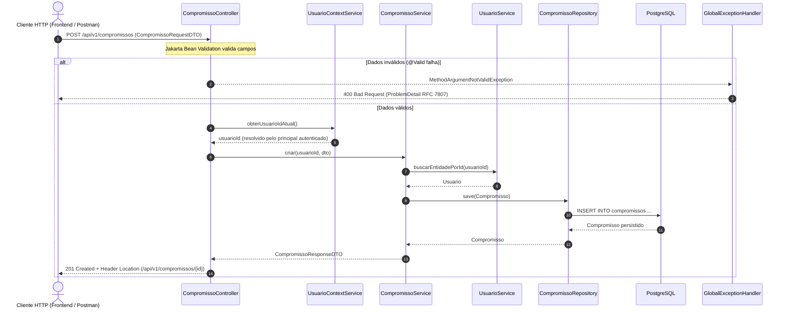
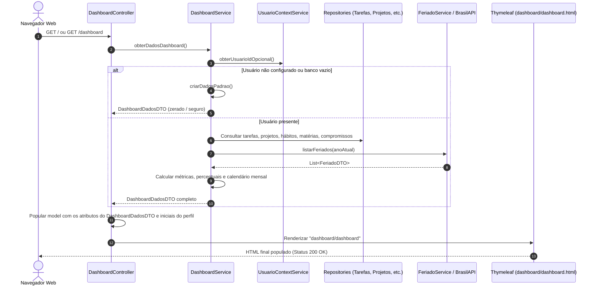

# Guia Técnico de Arquitetura e Funcionamento — IntelliPlan

Este documento apresenta a especificação técnica detalhada da arquitetura, do fluxo de execução, do modelo de dados, dos contratos de API e das integrações do **IntelliPlan — Organizador Pessoal Inteligente**.

---

## 1. Visão Geral e Estilo Arquitetural

O IntelliPlan é estruturado como um monolito modular baseado em **Java 21** e **Spring Boot 4.1.2**, com persistência relacional em **PostgreSQL** via **Spring Data JPA / Hibernate**, empacotado no formato **WAR (Web Application Archive)**. O projeto não fixa uma versão mínima do servidor PostgreSQL.

A aplicação atende simultaneamente a dois canais de consumo:
1. **Interface Web Server-Side:** Renderizada com **Thymeleaf**, **Tailwind CSS** (via CDN) e **JavaScript vanilla** para interação no navegador.
2. **API RESTful:** Disponibilizada sob o prefixo `/api/v1/`, formatada em JSON com validação Jakarta Bean Validation e documentação padronizada **OpenAPI 3.0 / Swagger UI**.

### Princípios de Engenharia Adotados

- **Injeção de Dependências Explícita:** Todos os componentes do Spring utilizam injeção via construtor, sem uso de anotações `@Autowired` em campos ou setters.
- **Sem Lombok:** Todas as entidades possuem construtores, getters e setters explícitos; todos os DTOs utilizam **Java Records**.
- **Isolamento de Dados nos Serviços:** O `UsuarioContextService` resolve o ID pelo e-mail do principal autenticado e os services de domínio limitam operações ao usuário atual.
- **Segurança Web:** O `SecurityConfig` configura login por formulário, sessão, autorização por rota e mantém CSRF habilitado. O fluxo `/setup` permite criação pública de contas; essa política deve ser considerada ao publicar a aplicação.
- **Tratamento de Exceções Padronizado:** Erros de validação, integridade, regras de negócio e recursos não encontrados são mapeados pelo `GlobalExceptionHandler` no formato RFC 7807 (`ProblemDetail`).
- **Integrações com Cache:** As consultas de feriados e localidades são cacheadas em memória. Falha de um provider de feriados não impede a consolidação dos dados retornados pelos demais providers disponíveis; uma resposta parcial não é cacheada.

---

## 2. Estrutura de Pacotes

A organização de código do IntelliPlan adota modularização por domínio funcional:

```
com.planner
├── agenda
│   ├── controller      # CompromissoController (REST) e AgendaViewController (MVC)
│   ├── dto             # CompromissoRequestDTO, CompromissoResponseDTO
│   ├── entity          # Compromisso (JPA)
│   ├── repository      # CompromissoRepository (Spring Data JPA)
│   └── service         # CompromissoService (Regras de negócio e isolamento)
├── common
│   ├── context         # UsuarioContextService (Resolução do usuário corrente)
│   ├── exception       # BusinessRuleException, ResourceNotFoundException, DuplicateResourceException
│   └── handler         # GlobalExceptionHandler (@RestControllerAdvice)
├── config
│   ├── localidade      # Cliente/serviço IBGE, DTOs e API de localidades
│   ├── setup           # Assistente de instalação e persistência de configuração local
│   ├── ConfiguracoesViewController
│   └── SecurityConfig  # SecurityFilterChain e BCryptPasswordEncoder
├── dashboard
│   ├── controller      # DashboardController (@Controller para renderização Thymeleaf e ações MVC)
│   ├── dto             # DiaHabitoDTO, DiaCalendarioDTO, TarefaItemDTO, ProjetoItemDTO, MateriaItemDTO, DashboardDadosDTO
│   └── service         # DashboardService (Agregação de métricas, progresso e calendário)
├── estudos
│   ├── controller      # MateriaController, ConteudoEstudoController (REST)
│   ├── dto             # MateriaRequestDTO, MateriaResponseDTO, ConteudoEstudoRequestDTO, ConteudoEstudoResponseDTO
│   ├── entity          # Materia, ConteudoEstudo (JPA)
│   ├── repository      # MateriaRepository, ConteudoEstudoRepository
│   └── service         # MateriaService, ConteudoEstudoService
├── habitos
│   ├── controller      # HabitoController, RegistroHabitoController (REST)
│   ├── dto             # HabitoRequestDTO, HabitoResponseDTO, RegistroHabitoRequestDTO, RegistroHabitoResponseDTO
│   ├── entity          # Habito, RegistroHabito (JPA)
│   ├── repository      # HabitoRepository, RegistroHabitoRepository
│   └── service         # HabitoService, RegistroHabitoService
├── integracao
│   └── feriados
│       ├── client      # BrasilApiClient (RestClient HTTP com timeouts configurados)
│       ├── controller  # FeriadoController (REST para consulta de feriados)
│       ├── dto         # FeriadoDTO, categoria e incidências com fonte/referência
│       └── service     # FeriadoService, FeriadoProvider e provedores legais
├── notificacao
│   ├── controller      # NotificacaoController (REST)
│   ├── entity          # Notificacao (JPA)
│   ├── repository      # NotificacaoRepository
│   └── service         # Sincronização e leitura por usuário
├── projeto
│   ├── controller      # ProjetoController (REST) e ProjetoViewController (MVC)
│   ├── dto             # ProjetoRequestDTO, ProjetoResponseDTO
│   ├── entity          # Projeto (JPA)
│   ├── repository      # ProjetoRepository
│   └── service         # ProjetoService
├── tarefa
│   ├── controller      # TarefaViewController (MVC/Thymeleaf; sem controller REST)
│   ├── dto             # TarefaRequestDTO, TarefaResponseDTO
│   ├── entity          # Tarefa (JPA)
│   ├── repository      # TarefaRepository
│   └── service         # TarefaService
└── usuario
    ├── controller      # UsuarioController (REST) e LoginViewController
    ├── dto             # UsuarioRequestDTO, UsuarioResponseDTO
    ├── entity          # Usuario (JPA)
    ├── repository      # UsuarioRepository
    └── service         # UsuarioService e IntelliPlanUserDetailsService
```

---

## 3. Ciclo de Vida de uma Requisição

### 3.1 Requisição REST (Exemplo: Criação de Compromisso)



### 3.2 Requisição Web MVC (Exemplo: Acesso ao Dashboard)



---

## 4. Modelo de Dados e Entidades JPA

O modelo relacional contém nove entidades JPA. A localização da instalação e as configurações de conexão ficam em arquivo de propriedades fora do banco.

| Entidade | Tabela | Descrição | Relacionamentos Principais |
|---|---|---|---|
| `Usuario` | `usuarios` | Titular da conta e proprietário das informações. | Possui Tarefas, Projetos, Matérias, Compromissos, Hábitos e Notificações. Restrição: `uk_usuarios_email`. |
| `Projeto` | `projetos` | Agrupador de escopos e atividades. | `ManyToOne` -> `Usuario` (`usuario_id`, FK obrigatória, Fetch LAZY). |
| `Tarefa` | `tarefas` | Unidade de atividade com status e prazo. | `ManyToOne` -> `Usuario` (`usuario_id`, FK obrigatória). `ManyToOne` -> `Projeto` (`projeto_id`, FK opcional). |
| `Materia` | `materias` | Disciplina ou área acadêmica/estudo. | `ManyToOne` -> `Usuario` (`usuario_id`, FK obrigatória, Fetch LAZY). |
| `ConteudoEstudo` | `conteudos_estudo` | Tópico ou capítulo de uma disciplina. | `ManyToOne` -> `Materia` (`materia_id`, FK obrigatória, Fetch LAZY). |
| `Compromisso` | `compromissos` | Evento pontual com horário de início e término. | `ManyToOne` -> `Usuario` (`usuario_id`, FK obrigatória, Fetch LAZY). |
| `Habito` | `habitos` | Ação recorrente monitorada com frequência diária, semanal ou mensal. | `ManyToOne` -> `Usuario` (`usuario_id`, FK obrigatória, Fetch LAZY). |
| `RegistroHabito` | `registros_habito` | Log de execução diária de um hábito. | `ManyToOne` -> `Habito` (`habito_id`, FK obrigatória, Fetch LAZY). Restrição: `uk_registro_habito_data (habito_id, data_registro)`. |
| `Notificacao` | `notificacoes` | Lembrete persistido associado ao usuário e ao evento de origem. | `ManyToOne` -> `Usuario` (`usuario_id`, FK obrigatória, Fetch LAZY). Restrição `uk_notificacao_evento (usuario_id, chave_evento)` e índice por usuário/data. |

### Regras de Integridade e Constraints Críticas

1. **Unicidade de E-mail (`uk_usuarios_email`):** Não é permitido cadastrar mais de um usuário com o mesmo e-mail. Caso ocorra concorrência, a violação é capturada e transformada em `DuplicateResourceException` (HTTP 409).
2. **Unicidade de Registro de Hábito por Data (`uk_registro_habito_data`):** Um mesmo hábito não pode ter mais de uma confirmação na mesma data (`data_registro`). Tentativas duplicadas disparam `DuplicateResourceException` (HTTP 409).
3. **Unicidade de evento de notificação (`uk_notificacao_evento`):** Evita persistir mais de uma notificação do mesmo evento para o mesmo usuário.
4. **Isolamento de Domínio:** Os services verificam o proprietário ou consultam por ID e usuário. Recursos fora do escopo atual são tratados como não encontrados.

---

## 5. Resolução de Contexto do Usuário (`UsuarioContextService`)

`UsuarioContextService` lê o `Authentication` do `SecurityContextHolder`, normaliza o e-mail do principal e resolve o ID no `UsuarioRepository`. `obterUsuarioIdAtual()` exige usuário resolvido e `obterUsuarioIdOpcional()` retorna `Optional.empty()` quando a identidade não está disponível. O código não usa `app.dev.usuario-id`.

### Autenticação e autorização

`IntelliPlanUserDetailsService` procura a conta por e-mail normalizado e devolve a credencial BCrypt com a role `USER`. O `SecurityConfig` configura login por formulário em `/login` (`email` e `senha`), redireciona após autenticação para `/dashboard` e configura logout em `POST /logout`. A sessão migra ao autenticar e permite uma sessão ativa por conta; um novo login substitui a sessão anterior. O CSRF padrão do Spring Security não é desabilitado.

| Grupo de rotas | Regra observada em `SecurityConfig` |
|---|---|
| `/login`, `/setup/**`, `/css/**`, `/js/**`, `/images/**`, `/icons/**`, `/error` | Público. |
| `/api/v1/localidades/**` | Público; somente endpoints GET estão implementados. |
| `/swagger-ui/**`, `/v3/api-docs/**` | Requer role `USER`. |
| `POST /api/v1/usuarios` | Negado explicitamente. |
| Demais `/api/**` e páginas | Requer autenticação. |

A criação de contas ocorre pelo formulário público `/setup/criar-conta`, inclusive após a instalação estar concluída; não existe endpoint REST de cadastro. Na instalação inicial, a localização é obrigatória e a conta criada é marcada como principal. Após a instalação, o formulário permite criar outras contas e a localização permanece global. Trate essa política de cadastro público como uma decisão operacional ao publicar a aplicação.

O endpoint `GET /api/v1/usuarios/{id}` só retorna o registro correspondente ao principal autenticado; tentar consultar outro ID é negado. A página `/configuracoes` permite alterar a senha exigindo a senha atual e, após a alteração, encerra a sessão.

---

## 6. Integração de feriados nacionais, estaduais e municipais

O pacote `com.planner.integracao.feriados` centraliza as consultas, normalização e consolidação. Dashboard, Agenda e API REST usam o mesmo `FeriadoService`; não há uma segunda integração por página.

### Fontes e cobertura efetiva

| Categoria | Fonte/procedência | Cobertura implementada |
|---|---|---|
| Nacional | BrasilAPI (`https://brasilapi.com.br/api/feriados/v1/{ano}`), com datas filtradas conforme Lei Federal nº 662/1949 (alterada pela Lei nº 10.607/2002), Lei nº 6.802/1980 e Lei nº 14.759/2023 | Datas nacionais legais identificadas pela BrasilAPI. Carnaval, Sexta-feira Santa e Corpus Christi são apresentados separadamente como pontos facultativos. Quarta-feira de Cinzas foi adicionada para 2026 conforme o calendário federal daquele ano; anos futuros dependem da publicação anual. Páscoa e datas sem classificação jurídica sustentada não são incluídas. |
| Estadual | Assembleia Legislativa de São Paulo, Lei Estadual nº 9.497/1997, art. 1º ([texto oficial](https://www.al.sp.gov.br/repositorio/legislacao/lei/1997/lei-9497-05.03.1997.html)) | Estado de SP: 9 de julho. |
| Municipal | Lei Orgânica de Santos (dispositivos municipais de feriados) e Decreto Municipal nº 11.111/2025, calendário oficial de 2026, publicado no Diário Oficial | Município de Santos/SP (código IBGE 3548500): 26 de janeiro, Sexta-feira da Paixão, Corpus Christi e 8 de setembro. Datas móveis são calculadas a partir da Páscoa. O decreto anual corrobora 2026; novos municípios exigem provedores e fontes próprios. |
| Geográfica | Serviço de localidades do IBGE (`https://servicodados.ibge.gov.br/api/v1/localidades`) | Estados e municípios para seleção e validação. O IBGE não é usado como fonte de feriados. |

A cobertura regional é intencionalmente parcial: para outros municípios do Brasil, a API e a interface mostram somente feriados nacionais e não simulam cobertura estadual/municipal. A Prefeitura de Santos disponibiliza o portal Legis como índice informativo e orienta a consulta ao Diário Oficial para o texto juridicamente oficial; por isso, a referência municipal exibida preserva o nome da fonte e do ato, sem alegar que exista uma API municipal nacional.

### Modelo e consolidação

`FeriadoDTO` contém data, nome e uma lista de incidências. Cada incidência informa categoria (`NACIONAL`, `ESTADUAL`, `MUNICIPAL` ou `PONTO_FACULTATIVO`), UF/código IBGE aplicáveis, fonte e referência. Ponto facultativo é exibido com classificação visual e textual própria, sem ser apresentado como feriado nacional. Incidências da mesma data são consolidadas em um registro, sem apagar classificações coincidentes. Dashboard e Agenda mostram o nome e as categorias; compromissos continuam separados.

`BrasilApiClient` usa `RestClient` com timeout de conexão de 3 segundos e leitura de 5 segundos. O `BrasilApiNacionalFeriadoProvider` aceita apenas as datas federais definidas por lei; os provedores regionais só respondem quando UF e código IBGE correspondem à jurisdição coberta.

### Cache e indisponibilidade

`FeriadoService` usa cache em memória com TTL de 12 horas e chave por ano, UF, código IBGE e escopo dos provedores aplicáveis. Respostas vazias válidas são cacheadas. Se qualquer provedor falhar, seus dados não são tratados como resposta válida nem a falha é cacheada; os dados dos provedores disponíveis ainda são retornados. A próxima consulta tenta novamente o provedor indisponível. O cache é limpo ao atualizar a localização e não depende de Redis ou de outro serviço.

### Localização, segurança e endpoints

A localização da instalação é persistida em `~/.intelliplan/application.properties` (ou no caminho definido por `INTELLIPLAN_CONFIG_FILE`) e compartilhada por todos os usuários da instalação. O assistente inicial exige estado e município; a página autenticada `/configuracoes` permite alterá-los. O backend valida UF, nome do município e código IBGE contra os dados do IBGE antes de persistir. A gravação usa POST, autenticação e CSRF do Spring Security.

| Método | Rota | Acesso | Ação |
|---|---|---|---|
| `GET` | `/api/v1/localidades/estados` | Público, somente leitura | Lista estados brasileiros do IBGE. |
| `GET` | `/api/v1/localidades/estados/{uf}/municipios` | Público, somente leitura | Lista municípios da UF no IBGE. |
| `POST` | `/configuracoes/localizacao` | Autenticado + CSRF | Valida e atualiza localização da instalação. |
| `GET` | `/api/v1/feriados/{ano}` | Autenticado | Retorna feriados nacionais e regionais cobertos, com incidências, fontes e referências. |

---

## 7. Mapeamento da API REST

A API usa prefixo `/api/v1`. Exceto as rotas públicas de localidades, os endpoints REST exigem uma sessão autenticada. Os principais códigos indicados abaixo são os declarados pelos controllers; autenticação, autorização e falhas do framework também podem produzir respostas próprias. Tarefas são expostas pela interface MVC, não por REST.

| Recurso | Método e rota | Parâmetros relevantes / resposta |
|---|---|---|
| Usuários | `GET /api/v1/usuarios/{id}` | Consulta autenticada do próprio usuário; 200 ou 404. Outro ID é negado. `POST /api/v1/usuarios` é bloqueado pelo filtro de segurança; não existe rota `por-email`. |
| Projetos | `POST /api/v1/projetos`, `GET /api/v1/projetos`, `GET /api/v1/projetos/{id}`, `PUT /api/v1/projetos/{id}`, `DELETE /api/v1/projetos/{id}` | Listagem aceita `status` opcional. Criar retorna 201; excluir retorna 204. |
| Matérias | `POST /api/v1/materias`, `GET /api/v1/materias`, `GET /api/v1/materias/{id}`, `PUT /api/v1/materias/{id}`, `DELETE /api/v1/materias/{id}` | CRUD de matérias do usuário; criar retorna 201 e excluir 204. |
| Conteúdos de estudo | `POST /api/v1/conteudos-estudo`, `GET /api/v1/conteudos-estudo`, `GET /api/v1/conteudos-estudo/{id}`, `PUT /api/v1/conteudos-estudo/{id}`, `DELETE /api/v1/conteudos-estudo/{id}` | Listagem requer `materiaId` e aceita `status` opcional; criar retorna 201 e excluir 204. |
| Compromissos | `POST /api/v1/compromissos`, `GET /api/v1/compromissos`, `GET /api/v1/compromissos/{id}`, `PUT /api/v1/compromissos/{id}`, `DELETE /api/v1/compromissos/{id}` | Listagem aceita `inicio` e `fim` ISO date-time opcionais; criar retorna 201 e excluir 204. |
| Hábitos | `POST /api/v1/habitos`, `GET /api/v1/habitos`, `GET /api/v1/habitos/{id}`, `PUT /api/v1/habitos/{id}`, `PATCH /api/v1/habitos/{id}/ativar`, `PATCH /api/v1/habitos/{id}/desativar`, `DELETE /api/v1/habitos/{id}` | Listagem usa `apenasAtivos` (padrão `false`); criar retorna 201 e excluir 204. |
| Registros de hábito | `POST /api/v1/registros-habito`, `GET /api/v1/registros-habito`, `GET /api/v1/habitos/{habitoId}/registros`, `GET /api/v1/registros-habito/{id}`, `DELETE /api/v1/registros-habito/{id}` | Lista requer `habitoId`; `inicio`/`fim` são filtros ISO date opcionais. A rota aninhada é uma alternativa GET. Criar retorna 201 e excluir 204. |
| Notificações | `GET /api/v1/notificacoes`, `POST /api/v1/notificacoes/sincronizar`, `PATCH /api/v1/notificacoes/{id}/lida`, `PATCH /api/v1/notificacoes/lidas` | Lista as 30 mais recentes e o total não lido; a última rota retorna 204. |
| Feriados | `GET /api/v1/feriados/{ano}` | Retorna as incidências agregadas disponíveis para a localização global da instalação. |
| Localidades | `GET /api/v1/localidades/estados`, `GET /api/v1/localidades/estados/{uf}/municipios` | Rotas públicas de leitura; dados consultados no IBGE e cacheados em memória por 24 horas. |

As operações que criam recursos validam DTOs com Jakarta Bean Validation. Para contratos e descrições OpenAPI, consulte `/swagger-ui/index.html` após autenticar.

---

## 8. Tratamento Global de Exceções

Para exceções que chegam ao dispatcher MVC, o `GlobalExceptionHandler` mapeia exceções de domínio e validação para `ProblemDetail` (RFC 7807). O handler também converte exceções MVC não previstas em uma resposta genérica 500. Respostas produzidas antes do dispatcher pelos filtros do Spring Security não passam por esse advice.

| Exceção/condição | Status e conteúdo |
|---|---|
| `ResourceNotFoundException` | 404, título “Recurso não encontrado”. |
| `BusinessRuleException` | 400, título “Regra de negócio violada”. |
| `DuplicateResourceException` | 409, título “Recurso duplicado”. |
| DTO inválido, constraint, JSON inválido ou tipo de parâmetro inválido | 400; para DTOs, inclui mapa `erros` por campo. |
| Outra exceção MVC | 500 com detalhe genérico; a causa interna não é devolvida no corpo. |

Exemplo de resposta para recurso não encontrado:

```json
{
  "type": "https://api.intelliplan.com/erros/recurso-nao-encontrado",
  "title": "Recurso não encontrado",
  "status": 404,
  "detail": "Tarefa não encontrada.",
  "timestamp": "2026-11-22T12:00:00"
}
```

Para erros de validação de campos (`MethodArgumentNotValidException`), um mapa de erros específicos é incluído na propriedade `erros`:

```json
{
  "type": "https://api.intelliplan.com/erros/validacao-campos",
  "title": "Erro de validação nos campos da requisição",
  "status": 400,
  "detail": "Um ou mais campos contêm valores inválidos.",
  "erros": {
    "titulo": "O título da tarefa não pode estar em branco.",
    "status": "O status da tarefa é obrigatório."
  },
  "timestamp": "2026-11-22T12:00:00"
}
```

---

## 9. Dashboard e Interface Web

O `DashboardController` atende às rotas autenticadas `GET /` e `GET /dashboard`. Ele coloca 17 atributos no model: os campos do `DashboardDadosDTO` e as iniciais calculadas para o perfil.

| Variável | Tipo | Origem e Significado |
|---|---|---|
| `usuarioNome` | `String` | Nome completo do usuário ou `'Usuário'` como padrão. |
| `usuarioIniciais` | `String` | Iniciais do nome para o fragmento de perfil. |
| `primeiroNome` | `String` | Primeiro nome extraído para o cumprimento no banner. |
| `totalTarefas` | `Long` | Contagem total de tarefas cadastradas pelo usuário. |
| `totalProjetos` | `Long` | Contagem total de projetos do usuário. |
| `totalHabitos` | `Long` | Contagem total de hábitos do usuário. |
| `diasHabitos` | `List<DiaHabitoDTO>` | Sequência dos últimos 7 dias com inicial do dia e flag de conclusão. |
| `mesAtual` | `String` | Mês e ano formatados em português (ex.: `"Novembro de 2026"`). |
| `diasCalendario` | `List<DiaCalendarioDTO>` | Dias do mês corrente, identificando o dia de hoje, eventos e feriados com nome/categoria. |
| `tarefasHoje` | `List<TarefaItemDTO>` | Tarefas do dia ou pendentes para execução imediata. |
| `progressoGeral` | `Integer` | Média consolidada de progresso (0 a 100%). |
| `progressoTarefas` | `String` | Percentual de tarefas concluídas formatado com `"%"` (ex.: `"75%"`). |
| `progressoEstudos` | `String` | Percentual de conteúdos concluídos em matérias (ex.: `"50%"`). |
| `progressoHabitos` | `String` | Percentual de hábitos ativos concluídos no dia de hoje (ex.: `"60%"`). |
| `progressoProjetos` | `String` | Percentual de projetos com status `CONCLUIDO` (ex.: `"40%"`). |
| `projetosAtivos` | `List<ProjetoItemDTO>` | Projetos em andamento ou planejados com nome, descrição e progresso individual baseado em suas tarefas. |
| `materias` | `List<MateriaItemDTO>` | Matérias cadastradas com conteúdo em andamento atual e percentual de progresso concluído. |

O dashboard exibe até cinco tarefas em aberto ou com vencimento no dia, até cinco projetos planejados/em andamento e até cinco matérias. A média geral é calculada a partir dos percentuais de tarefas, estudos, hábitos e projetos. Sem usuário resolvido, o service fornece coleções vazias e métricas zeradas; o acesso HTTP à página continua protegido pela autenticação.

### Rotas MVC e telas

| Área | Rotas principais |
|---|---|
| Login | `GET /login`; processamento do formulário em `POST /login` pelo Spring Security. |
| Instalação/contas | `GET /setup`, `POST /setup/testar`, `POST /setup/criar-conta`. |
| Dashboard | `GET /`, `GET /dashboard`, `POST /tarefas/{id}/concluir`. |
| Tarefas | `GET /tarefas`, `GET /tarefas/nova`, `POST /tarefas`, `GET/POST /tarefas/{id}/editar`, `POST /tarefas/{id}/excluir`. |
| Projetos | `GET /projetos`, `GET /projetos/novo`, `POST /projetos`, `GET /projetos/{id}`, `GET/POST /projetos/{id}/editar`, `POST /projetos/{id}/excluir`. |
| Estudos | `GET /estudos`, `GET /estudos/nova`, `POST /estudos`, `GET /estudos/{id}`, edição/exclusão da matéria em `/{id}/editar` e `/{id}/excluir`; criação/edição/exclusão de conteúdo em `/estudos/{materiaId}/conteudos...`. |
| Agenda | `GET /agenda` (filtros `ano`/`mes`), `GET /agenda/novo`, `POST /agenda`, `GET/POST /agenda/{id}/editar`, `POST /agenda/{id}/excluir`. |
| Hábitos | `GET /habitos`, `GET /habitos/novo`, `POST /habitos`, `GET/POST /habitos/{id}/editar`, `POST /habitos/{id}/registrar`, `POST /habitos/{id}/ativar`, `POST /habitos/{id}/desativar`, `POST /habitos/{id}/excluir` e `POST /habitos/registros/{registroId}/excluir`. |
| Configurações | `GET /configuracoes`, `POST /configuracoes/localizacao` e `POST /configuracoes/senha`. |

As páginas compartilham fragments de navegação, perfil e notificações. O CSS responsivo e os templates são servidos pelo próprio Spring Boot; não há aplicação SPA nem build de frontend separado. A seleção de município consulta os endpoints públicos do IBGE, exibe estados de carregamento/erro e valida novamente a combinação no backend. A central de notificações consulta a API autenticada com `credentials: same-origin` e token CSRF nas mutações; os erros são exibidos na interface.

### Descrições em Markdown

As descrições permanecem strings nos DTOs/entidades. O script compartilhado `static/js/components/markdown-renderer.js` interpreta o Markdown nos previews dos formulários e nas visualizações de tarefas, projetos, estudos, hábitos, compromissos e dashboard. A saída é montada por nós DOM, sem inserir HTML digitado como markup; links são limitados a `http`, `https`, `mailto` e caminhos resolvidos para protocolos permitidos. O conjunto suportado cobre negrito, itálico, tachado, títulos, listas simples, links, código em linha/bloco, parágrafos e quebras de linha; não equivale à especificação CommonMark completa.
